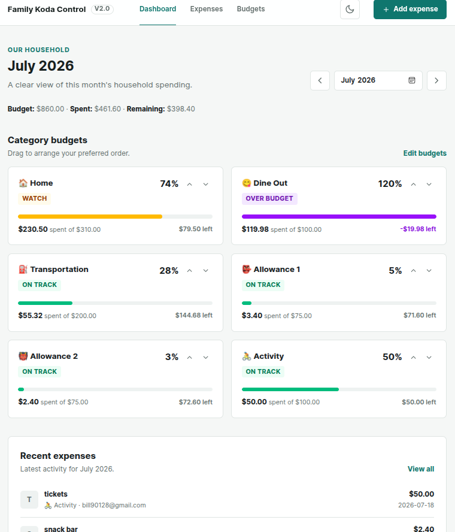
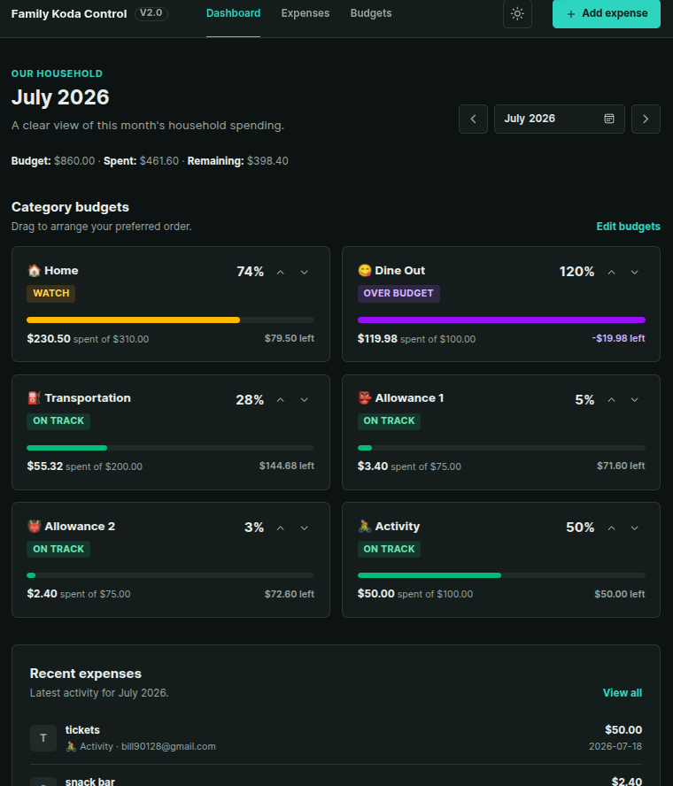
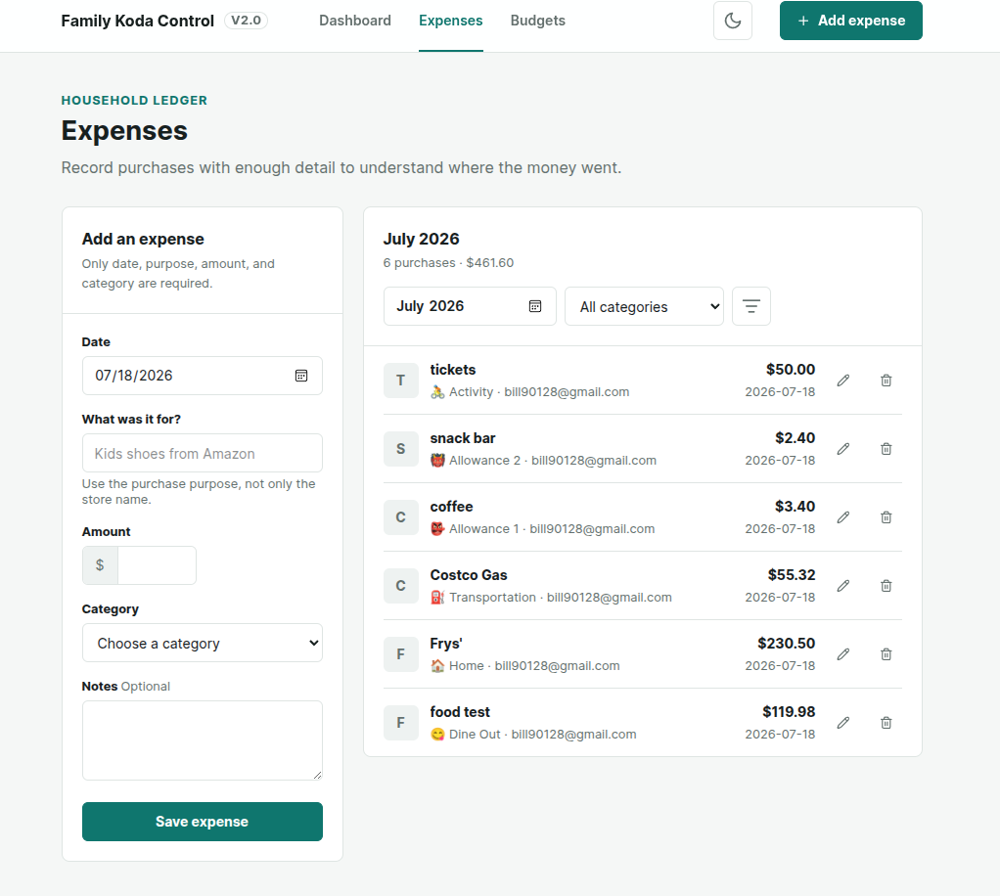
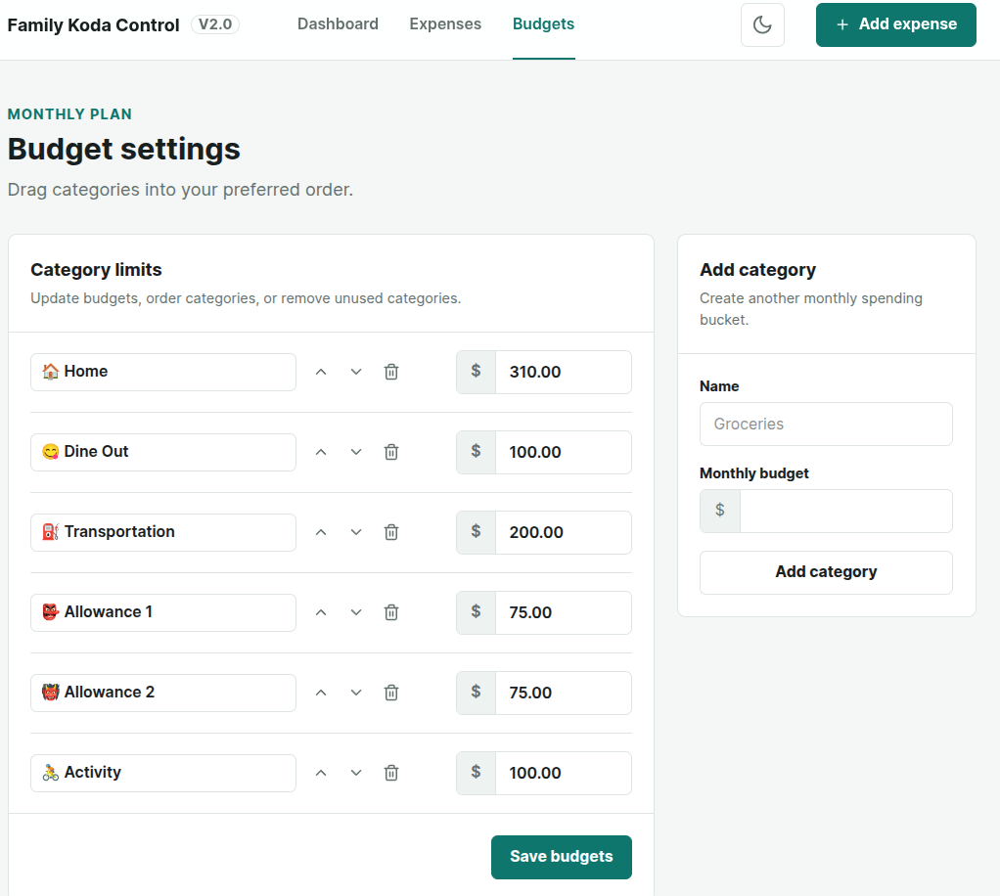
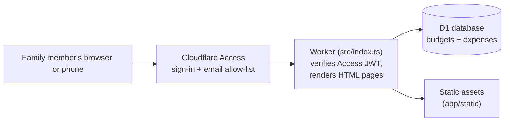
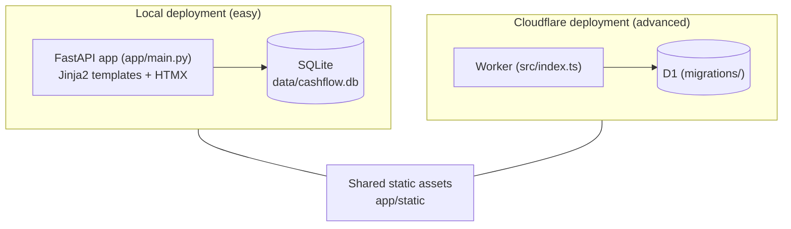

# Family Koda Control


A private family finance command center for managing monthly budgets,
tracking expenses, and understanding household spending behavior.

This is not a SaaS product. There is no registration, no multi-tenant
cloud, and no one else holding your data. You run it yourself — on a
laptop at home or on your own Cloudflare account — and the only users
are the people in your household.

## Why control cash flow this way?

Most families do not fail at budgeting because the math is hard. They
fail because nobody can see the answer to three simple questions while
the month is still happening:

- **How much budget do we have left this month?**
- **Which categories are getting close to overspending?**
- **Where is our money going?**

Family Koda Control puts those three answers on one dashboard. Every
category has a monthly budget and a color-coded status — green, yellow,
red, and purple for over budget — so a category drifting toward its
limit is visible *before* month-end, not discovered afterward on a bank
statement. Overspending is never blocked, only made obvious: the goal is
understanding spending behavior, not policing it.

**Pro-Tips for Success**
- **Deduct Fixed Expenses First:** Knock out rent and bills first, then budget the remaining disposable income. Budgeting isn't just about managing money—it’s about managing desires.
- **Categorize by Intent:** Use **Home** for groceries, **Dine Out** for takeout cravings, **Activity** for family outings, and keep a **Allowence** for yourself to spend on whatever you want.
- **Check Before You Spend:** Treat your budget like a punch card. Glance at the dashboard to see how many "punches" you have left before you tap your card.
- **Keep It Simple:** Don't get bogged down in micro-details. If you spend $50 at Walmart, just log $50 under **Home**. You can split bills to different categories, but don't overcomplicate it.

*Consistency beats perfection. Find a rhythm that works for you and stick to it.*

## Features

- Current and historical monthly dashboards
- Recurring category budgets with clear usage indicators
- Green, yellow, red, and purple budget status levels
- Manual expense entry with editing, category filtering, and drilldown
- Drag-and-drop category ordering
- Exact integer-cent calculations
- Light and dark (night) mode, remembered per device and defaulting to
  your system preference
- Responsive desktop and mobile layouts
- Two ways to run the same app:
  - **Local** — Python + SQLite, a single portable database file at
    `data/cashflow.db`, perfect for a home machine
  - **Cloudflare (advanced)** — a Worker + D1 database protected by
    Cloudflare Access, with verified sign-in for each family member

`TODO` *Future versions will integrate AI to automatically process
receipts, suggest categories, and provide spending insights.*

## Screenshots

<table>
  <tr>
    <td align="center">
      <br>
      <b>Dashboard (Light)</b>
    </td>
    <td align="center">
      <br>
      <b>Dashboard (Dark)</b>
    </td>
  </tr>
  <tr>
    <td align="center">
      <br>
      <b>Expense Settings</b>
    </td>
    <td align="center">
      <br>
      <b>Budget Settings</b>
    </td>
  </tr>
</table>


## Quick start: run it locally

This is the easy path and the recommended starting point.

### Prerequisites

- Python 3.11+
- Node.js 20+ (only used to build the CSS bundle)

### Setup and run

```bash
python3 -m venv .venv
.venv/bin/pip install -r requirements.txt
npm install
npm run build
```
Then start to host on local
```
.venv/bin/uvicorn app.main:app --reload
```

Open <http://127.0.0.1:8000>. The database and six starter budget
categories are created automatically on the first launch.

### Use it from your phone (mini home server)

A great setup is to run the app on a small always-on machine — an old
laptop works perfectly — and let everyone in the family add expenses
from their phones on the home Wi-Fi.

1. Give the server a **fixed IP address** on your home network. The
   most reliable way is a DHCP reservation in your router's admin page
   (sometimes called "static lease"), so the machine always gets the
   same address, for example `192.168.1.50`.
2. Start the app listening on all interfaces instead of localhost:

   ```bash
   .venv/bin/uvicorn app.main:app --host 0.0.0.0 --port 8000
   ```

3. On any phone or computer connected to the same Wi-Fi, open
   `http://192.168.1.50:8000` (use your server's address) and bookmark
   it to the home screen.

> **Note:** the local version has no login screen. It is designed for a
> trusted home network only — do not port-forward it to the internet.
> If you want access from anywhere with proper sign-in, use the
> Cloudflare deployment below.

### Configuration

The app works without configuration. These optional environment
variables are available:

| Variable | Default | Purpose |
| --- | --- | --- |
| `CASHFLOW_DB_PATH` | `data/cashflow.db` | Use a different SQLite file |
| `HOUSEHOLD_NAME` | `Our Household` | Name shown on a new database |

There is no configuration file to edit — set the variables in the
shell when starting the server:

```bash
HOUSEHOLD_NAME="The Smith Family" .venv/bin/uvicorn app.main:app --host 0.0.0.0 --port 8000
```

Notes:

- `HOUSEHOLD_NAME` is only read when a brand-new database is created
  on first launch. To rename an existing household, update the
  database instead:

  ```bash
  sqlite3 data/cashflow.db "UPDATE household SET name='The Smith Family'"
  ```

- If you run the app as a service (systemd, launchd, Docker), set the
  variables in the service definition the same way you would for any
  other app.

### Tests

```bash
.venv/bin/pytest
```

### Backup

Stop the application, then copy `data/cashflow.db` to the backup
location of your choice. Restoring that one file restores all budgets
and expenses.

## Advanced: deploy on Cloudflare

The hosted version runs as a Cloudflare Worker backed by a Cloudflare
D1 database, protected by Cloudflare Access. This gives your family:

- Access from anywhere, not just the home Wi-Fi
- A real sign-in step — only allow-listed emails get through
- Expenses automatically attributed to the verified signed-in member
- No server at home to keep running

The free Cloudflare tier is more than enough for one household.

### 1. Prepare accounts and tools

- A [Cloudflare account](https://dash.cloudflare.com/sign-up) (free)
- Node.js 20+ — the `wrangler` CLI runs through `npx`, no global
  install needed
- **Cloudflare Access set up for your team** (this is the part worth
  doing carefully):
  1. In the Cloudflare dashboard, open **Zero Trust** and create a team
     if you don't have one. Note your team domain, e.g.
     `https://your-team.cloudflareaccess.com`.
  2. Create an **Access application** for the Worker's URL.
  3. Add a policy that allows only your family members' email
     addresses.
  4. Copy the application's **AUD tag** from the application overview.

### 2. Configure the project

The repository ships only a template config. Copy it, then fill in your
own values:

```bash
cp wrangler.jsonc.example wrangler.jsonc
```

Edit your new `wrangler.jsonc` and replace the placeholders:

- `ACCESS_TEAM_DOMAIN` — your team domain from step 1
- `ACCESS_POLICY_AUD` — the AUD tag from step 1
- `database_id` — filled in during deployment below

Your `wrangler.jsonc` is listed in `.gitignore`, so the real values can
never be committed by accident — only the placeholder template
(`wrangler.jsonc.example`) lives in the repository. The Worker tests
and `wrangler dev` also read this file, so do this copy step before
running them.

> **Keep private values private.** If you fork this repository
> publicly, also never commit household email addresses, database
> exports, or `.dev.vars` files.

### 3. Deploy

```bash
npm install
npx wrangler login
npx wrangler d1 create koda-control-db   # paste the returned ID into wrangler.jsonc
npx wrangler types
npx vitest run
npx wrangler d1 migrations apply koda-control-db --remote
npx wrangler deploy
```

After the deploy finishes, the app is live at
`https://koda-control.<your-account-subdomain>.workers.dev` (wrangler
prints the exact URL). This is the URL your Cloudflare Access
application from step 1 must protect — visit it and confirm you are
asked to sign in before the dashboard appears.

### 4. Personalize the household name (optional)

The dashboard greets you with the household name, which starts as
"Our Household". Change it any time with one command:

```bash
npx wrangler d1 execute koda-control-db --remote --command "UPDATE household SET name='The Smith Family'"
```

Refresh the dashboard and the new name appears. (For the local
version, set the `HOUSEHOLD_NAME` environment variable before the
first launch instead — see the configuration table above.)

Run the migration command only when a new file has been added to
`migrations/`. Before changing the production database, create an
encrypted D1 export outside this repository.

For local Worker development and the full deployment reference, see
[`docs/cloudflare-development.md`](docs/cloudflare-development.md).

## Architecture

### Cloudflare deployment



Every request passes through Cloudflare Access first — visitors who are
not on the email allow-list never reach the application at all. The
Worker then independently verifies the Access JWT (`src/access.ts`) and
uses the verified email to attribute new expenses to the family member
who created them.

### The whole program

The repository contains two implementations of the same application
sharing one design:



## Project layout

```text
app/main.py              FastAPI routes and budget calculations (local)
app/database.py          SQLite schema, connection, and starter data (local)
app/templates/           Server-rendered Jinja2 pages (local)
app/static/              CSS bundle and local JS assets (both versions)
src/index.ts             Cloudflare Worker application (hosted)
src/access.ts            Cloudflare Access JWT verification (hosted)
migrations/              D1 schema migrations (hosted)
worker-test/             Worker integration tests (hosted)
tests/                   FastAPI application tests (local)
docs/                    Cloudflare development reference
data/cashflow.db         Local application data (created at runtime)
wrangler.jsonc.example   Worker + D1 config template (copy to wrangler.jsonc)
```

## Which files belong to which deployment?

If you only run the app locally, you can ignore everything in the
Cloudflare column. If you only deploy to Cloudflare, the local files
still serve as the reference implementation, but nothing in them runs
in production.

| | Local (original FastAPI app) | Cloudflare (hosted Worker) |
| --- | --- | --- |
| Application code | `app/main.py`, `app/database.py`, `app/__init__.py` | `src/index.ts`, `src/access.ts` |
| Pages / HTML | `app/templates/` (Jinja2) | Rendered inside `src/index.ts` |
| Database | SQLite file at `data/cashflow.db`, schema created by `app/database.py` | D1, schema created by `migrations/*.sql` |
| Tests | `tests/` (pytest) | `worker-test/` (vitest, runs in the Workers runtime) |
| Configuration | Environment variables (`CASHFLOW_DB_PATH`, `HOUSEHOLD_NAME`) | `wrangler.jsonc` (your local copy of `wrangler.jsonc.example`), `worker-configuration.d.ts` (generated types) |
| Dependencies | `requirements.txt`, `pyproject.toml` | `package.json` (wrangler, vitest), `tsconfig.json`, `vitest.config.mts` |
| Docs | This README's quick start | `docs/cloudflare-development.md` |

**Shared by both:** `app/static/` (the CSS bundle and local HTMX/Lucide
assets — the Worker serves this directory directly, and the FastAPI app
serves it as its static folder) and `package.json` (also provides the
Tailwind CSS build used by both versions).

The two test suites live in `tests/` (pytest, local app) and
`worker-test/` (vitest, Cloudflare Worker) — run the one matching the
version you are changing, or both when touching shared behavior.
